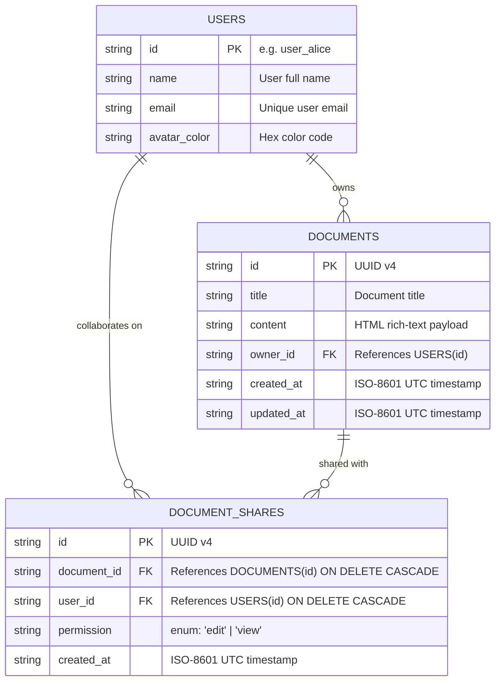

# Ajaia Docs — Architecture & System Design

This document details the architectural decisions, data model, security/access-control design, technical tradeoffs, and evolutionary roadmap for **Ajaia Docs**.

---

## 1. High-Level Architecture

Ajaia Docs follows a decoupled client-server architecture designed for high responsiveness, minimal operational complexity, and strict server-side authorization.

```
┌─────────────────────────────────────────────────────────────┐
│                       Client Browser                        │
│                                                             │
│   ┌─────────────────────────────────────────────────────┐   │
│   │               React + Vite Application              │   │
│   │                                                     │   │
│   │  ┌──────────────┐  ┌──────────────┐  ┌───────────┐  │   │
│   │  │   Sidebar    │  │    TopBar    │  │  TipTap   │  │   │
│   │  │ (Nav/Switch) │  │(Title/Status)│  │  Canvas   │  │   │
│   │  └──────────────┘  └──────────────┘  └───────────┘  │   │
│   │         │                 │                │        │   │
│   │  ┌───────────────────────────────────────────────┐  │   │
│   │  │      State Coordinator & Autosave Engine      │  │   │
│   │  └───────────────────────────────────────────────┘  │   │
│   └──────────────────────────┬──────────────────────────┘   │
└──────────────────────────────┼──────────────────────────────┘
                               │ HTTP / JSON (REST)
                               │ Header: X-User-Id
                               ▼
┌─────────────────────────────────────────────────────────────┐
│                    Python Flask Backend                     │
│                                                             │
│  ┌──────────────────┐  ┌──────────────────┐  ┌───────────┐  │
│  │   Auth & RBAC    │  │    Document      │  │ File      │  │
│  │   Middleware     │  │    Service       │  │ Importer  │  │
│  └──────────────────┘  └──────────────────┘  └───────────┘  │
│                               │                             │
│                               ▼                             │
│  ┌───────────────────────────────────────────────────────┐  │
│  │               SQLite Persistent Database              │  │
│  │            (WAL Mode, Cascade Foreign Keys)           │  │
│  └───────────────────────────────────────────────────────┘  │
└─────────────────────────────────────────────────────────────┘
```

### Component Responsibilities:
- **Frontend (React + Vite)**:
  - State management for active user, open document, and sidebar listings.
  - TipTap rich-text canvas with low-latency typography updates and toolbar synchronizations.
  - Autosave debouncing engine (750ms threshold) with real-time UI status updates (`Saved`, `Saving...`, `Error`).
- **Backend (Python Flask REST API)**:
  - User identity resolution via `X-User-Id`.
  - Authoritative access control validation on every document manipulation.
  - File import translation (Markdown `.md` and `.txt` to normalized HTML).
  - Health check monitoring endpoint.
- **Persistence (SQLite)**:
  - Single-file persistent relational store with foreign key enforcement and cascading deletes.

---

## 2. Data Model & Database Schema

The database schema is modeled in relational third normal form (3NF) to ensure integrity across ownership transfers and collaborator grants:

### Entity Relationship Diagram


### Schema Definitions (SQLite DDL):
```sql
CREATE TABLE IF NOT EXISTS users (
    id TEXT PRIMARY KEY,
    name TEXT NOT NULL,
    email TEXT UNIQUE NOT NULL,
    avatar_color TEXT NOT NULL
);

CREATE TABLE IF NOT EXISTS documents (
    id TEXT PRIMARY KEY,
    title TEXT NOT NULL,
    content TEXT NOT NULL,
    owner_id TEXT NOT NULL,
    created_at TEXT NOT NULL,
    updated_at TEXT NOT NULL,
    FOREIGN KEY (owner_id) REFERENCES users(id) ON DELETE CASCADE
);

CREATE TABLE IF NOT EXISTS document_shares (
    id TEXT PRIMARY KEY,
    document_id TEXT NOT NULL,
    user_id TEXT NOT NULL,
    permission TEXT NOT NULL DEFAULT 'edit',
    created_at TEXT NOT NULL,
    UNIQUE(document_id, user_id),
    FOREIGN KEY (document_id) REFERENCES documents(id) ON DELETE CASCADE,
    FOREIGN KEY (user_id) REFERENCES users(id) ON DELETE CASCADE
);
```

---

## 3. Access Control & Authorization Design

### Authentication Mechanism
For the scope of this assignment and to facilitate immediate pair-review and evaluation, authentication is implemented via a transparent **User Context Switcher** passing an `X-User-Id` HTTP header.
- **Honest Disclosure**: This mock authentication intentionally simulates identity switching without passwords or JWT session cookies so evaluators can rapidly test multi-user collaboration in a single browser window.
- The backend validates the `X-User-Id` against the seeded user registry on every request. If the header is missing or references a non-existent user, the API immediately returns `401 Unauthorized`.

### Role-Based Access Control (RBAC) Matrix
Permissions are verified on the backend before executing any database mutation:

| Action | Owner | Shared (Can Edit) | Shared (Can View) | Unshared User |
| :--- | :---: | :---: | :---: | :---: |
| **Read Document (`GET /api/documents/:id`)** | ✅ Allowed | ✅ Allowed | ✅ Allowed | ❌ `403 Forbidden` |
| **Edit Content (`PUT /api/documents/:id`)** | ✅ Allowed | ✅ Allowed | ❌ `403 Forbidden` | ❌ `403 Forbidden` |
| **Rename Title (`PUT /api/documents/:id`)** | ✅ Allowed | ✅ Allowed | ❌ `403 Forbidden` | ❌ `403 Forbidden` |
| **Share Document (`POST /api/documents/:id/share`)** | ✅ Allowed | ❌ `403 Forbidden` | ❌ `403 Forbidden` | ❌ `403 Forbidden` |
| **Revoke Share (`DELETE /api/documents/:id/share/:uid`)**| ✅ Allowed | ❌ `403 Forbidden` | ❌ `403 Forbidden` | ❌ `403 Forbidden` |
| **Delete Document (`DELETE /api/documents/:id`)** | ✅ Allowed | ❌ `403 Forbidden` | ❌ `403 Forbidden` | ❌ `403 Forbidden` |

Backend enforcement guarantees that malicious clients cannot manipulate documents simply by modifying client-side JavaScript or sending arbitrary REST payloads.

---

## 4. Key Architectural Tradeoffs

| Decision | Chosen Approach | Alternative Considered | Rationale |
| :--- | :--- | :--- | :--- |
| **Database** | SQLite with Foreign Keys | PostgreSQL / MySQL | Zero external database dependencies, instant zero-configuration local setup, highly portable, and perfectly suited for fast evaluation. |
| **Autosave** | Debounced REST (`750ms`) | WebSockets / CRDTs | Under the 3-hour deadline, debounced REST offers rock-solid reliability, easy debugging, testable idempotency, and eliminates complex merge-conflict overhead. |
| **Document Content Format** | HTML string | ProseMirror JSON tree | Direct HTML storage allows seamless Markdown/plain-text import rendering, export capabilities, and standard TipTap interoperability without custom schema serializations. |
| **Editor Framework** | TipTap (StarterKit + Underline) | Draft.js / Quill | TipTap provides an ultra-modern headless ProseMirror foundation, pristine TypeScript/React integrations, and full CSS layout freedom. |
| **Deployment Mode** | Dual-mode (Dev Vite + Single-Port Flask static serve) | Independent container cluster | Enables instant developer HMR on port 5173 while also supporting single-container zero-overhead deployment on port 5000. |

---

## 5. Future Engineering Roadmap

If allocated additional sprint cycles beyond the internship assignment scope, the following enhancements would be prioritized:

1. **Real-Time Collaborative Editing**:
   - Integrate **Yjs** with TipTap’s collaborative editing extension over WebSockets (via `y-websocket` or Redis pub/sub) for true multi-cursor live editing.
2. **Document Version History & Snapshots**:
   - Append-only `document_versions` table capturing point-in-time diffs with rollback capabilities.
3. **Comments & Inline Annotations**:
   - Threaded comment system anchored to document text ranges with `@mention` notifications.
4. **Production Authentication**:
   - Migrate mock user headers to OAuth 2.0 (Google/GitHub) or JWT bearer tokens with secure HTTP-only cookies and bcrypt password hashing.
5. **Rich Media & Attachments**:
   - S3-compatible object storage (e.g., AWS S3 or Cloudflare R2) for inline image and asset uploads.
